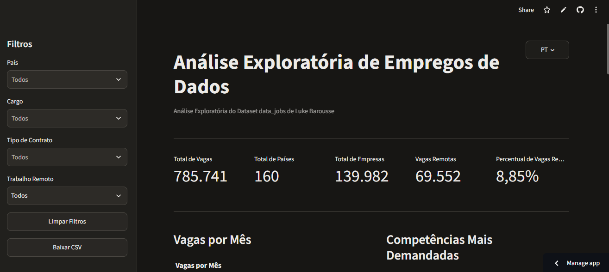
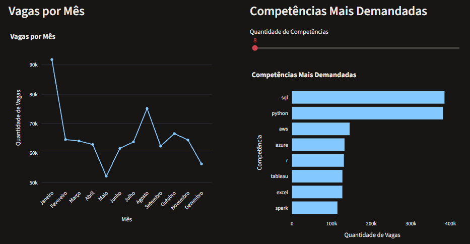

# Análise Exploratória da Área de Dados com o data_jobs Dataset
 
🔗 **[Acesse o app online](https://analyse-exploratoria-area-de-dados.streamlit.app/)**
 

 
## Descrição
Esse projeto utiliza o dataset [data_jobs](https://huggingface.co/datasets/lukebarousse/data_jobs) do Luke Barousse para conseguir informações sobre a área de dados de forma interativa, utilizando filtros, métricas e gráficos gerados automaticamente. O dataset é baixado direto do Hugging Face na primeira execução, então não é preciso baixar nenhum arquivo manualmente.

Esse aplicativo de análise exploratória foi criado como finalização do curso "[Python for Data Analytics](https://www.youtube.com/watch?v=wUSDVGivd-8)" do Luke Barousse, implementando praticamente tudo de Python base, manipulação de DataFrames com Pandas e geração de gráficos interativos.
 
O projeto é dividido em duas partes: Front-End com o `app.py`, e a lógica de análise com todos os arquivos dentro da pasta `src`.
 
O Front-End foi feito com assistência do ChatGPT (GPT-6), por ser uma área que eu não domino. Por outro lado, o carregamento e validação dos dados, as manipulações, as métricas e a estrutura da análise são de minha autoria.
 
Além disso, o projeto foi hospedado online no Streamlit para facilitar o uso.
 
## Principais Descobertas
1. Praticamente metade das vagas requisitam SQL;
2. O pico de oferta de empregos é em Janeiro;
3. O salário anual mediano é aproximadamente $120k;
4. O salário por hora mediano é aproximadamente $40;
5. Cientista de Dados Sênior é o cargo melhor remunerado dentre todos da área de dados.

## Tecnologias
Python · Pandas · Plotly · Matplotlib · Streamlit · Hugging Face Hub
 
## O que eu implementei
- **Carregamento e validação:** o programa confere se todas as colunas necessárias existem no dataset antes de qualquer análise, e retorna um erro claro caso falte alguma.
- **Tratamento dos dados:** conversão das datas de postagem para `datetime` e das habilidades, que vêm como texto, para listas reais com `ast.literal_eval`.
- **Filtros combináveis:** país, cargo, tipo de contrato e trabalho remoto. É possível selecionar vários valores de um mesmo filtro ao mesmo tempo.
- **Métricas calculadas dinamicamente:** total de vagas, países, empresas, vagas remotas e percentual de vagas remotas, sempre de acordo com os filtros ativos.
- **Competências mais demandadas:** uso de `collections.Counter` para contar as habilidades de cada vaga, com a quantidade de competências exibidas ajustável.
- **Análise salarial:** salário anual e por hora separados, com mínimo, máximo, média, mediana e histograma de distribuição.
- **Vagas por mês:** gráfico de linha com todos os meses, mesmo quando algum não possui vagas.
- **Download:** exportação em CSV do dataset com os filtros aplicados.
- **Dois idiomas:** Português e Inglês, incluindo mensagens de erro e formatação de números e valores.
- **Cache:** o dataset é carregado e tratado uma única vez, então trocar filtros não recarrega tudo de novo.

## Estrutura do projeto
```
├── app.py                # Interface (Streamlit)
├── requirements.txt
├── images
└── src/
    ├── data_loader.py    # Carregamento, validação e tratamento do dataset
    ├── data_analysis.py  # Filtros, métricas, top skills, vagas por mês e salários
    ├── visualization.py  # Versões dos gráficos em Matplotlib
    └── translations.py   # Textos em Português e Inglês
```
 
## Instalação
Caso queira utilizar o aplicativo localmente, siga estes passos:
 
1. Com o terminal, utilize o comando `git clone https://github.com/Miguel-Rasia/analise-exploratoria-area-de-dados` e entre na pasta com `cd analise-exploratoria-area-de-dados`
2. Instale as bibliotecas com o comando `pip install -r requirements.txt`
3. Com o terminal na pasta do projeto, execute o comando `python -m streamlit run app.py`. O aplicativo deve ser executado com o streamlit, e não como um arquivo Python.

Na primeira execução o dataset será baixado automaticamente, então ela pode demorar um pouco mais.
 
## Como usar
No site, há uma aba lateral no lado esquerdo com diversos filtros que você pode aplicar. É possível aplicar vários filtros de um mesmo tipo. O programa irá calcular as métricas e gerar automaticamente os gráficos para a seleção atual de filtros. Se quiser, é possível baixar um CSV do dataset com os filtros aplicados para utilizar como quiser.
 

 
Caso seja utilizada uma combinação de filtros que o dataset não possui dados, será retornada uma mensagem de que não há dados disponíveis.
 
No canto superior direito há uma seleção de idiomas, com Português e Inglês suportados no momento. O Streamlit também oferece opção de trocar o tema de exibição, e os gráficos acompanham o tema escolhido.
## Problemas Conhecidos
A plataforma Streamlit é bastante instável quando se trata de aplicativos que lidam com um volume significativo de dados. Por isso, o aplicativo pode ficar indisponível quando você tenta acessá-lo online.

Caso isso aconteça, utilize a versão local do aplicativo. Não há problemas em usá-lo dessa forma.

## Autor
**Miguel Rasia**  
Estudante de Ciência da Computação e interessado na área de Ciência de Dados.  
Fiz esse projeto para praticar Python, bibliotecas de manipulação de dados e aprender no geral.
 
[](https://www.linkedin.com/in/miguel-rasia-b4069b318/)
[](https://github.com/Miguel-Rasia)