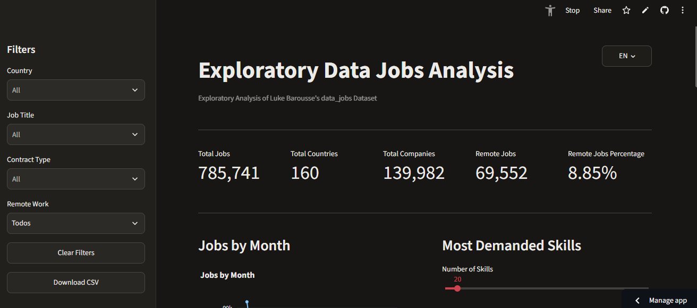
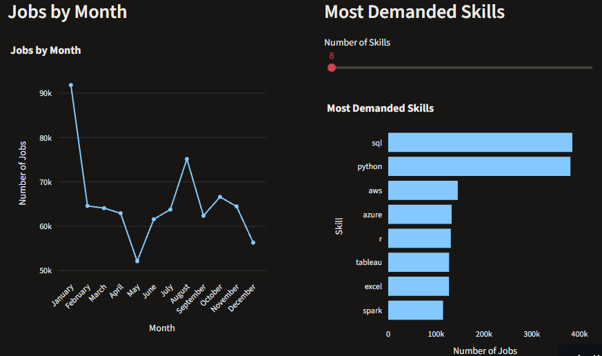

# Exploratory Analysis of the Data Job Market with the data_jobs Dataset
 
🔗 **[Access the online app](https://analyse-exploratoria-area-de-dados.streamlit.app/)**
 

 
## Description
This project uses Luke Barousse's [data_jobs](https://huggingface.co/datasets/lukebarousse/data_jobs) dataset to extract insights about the data field interactively, using filters, metrics, and automatically generated charts. The dataset is downloaded directly from Hugging Face on the first run, so there is no need to download any files manually.
 
The exploratory data app was created as the final project of the "[Python for Data Analytics](https://www.youtube.com/watch?v=wUSDVGivd-8)" course by Luke Barousse, applying practically everything from core Python, DataFrame manipulation with Pandas, and interactive chart generation.


The project is divided into two parts: the Front-End in `app.py`, and the analysis logic in all the files inside the `src` folder.
 
The Front-End was made with the assistance of ChatGPT (GPT-6), since it is an area I am not familiar with. On the other hand, the data loading and validation, the manipulations, the metrics, and the structure of the analysis are my own work.
 
In addition, the project was hosted online on Streamlit to make it easier to use.

## Key Findings
1. Almost half of the job postings require SQL;
2. Job postings peak in January;
3. The median yearly salary is approximately $120k;
4. The median hourly salary is approximately $40;
5. Senior Data Scientist is the highest-paid role among all data roles.
 
## Technologies
Python · Pandas · Plotly · Matplotlib · Streamlit · Hugging Face Hub
 
## What I implemented
- **Loading and validation:** the program checks that all required columns exist in the dataset before any analysis, and returns a clear error if any is missing.
- **Data processing:** conversion of posting dates to `datetime` and of skills, which come as text, into real lists with `ast.literal_eval`.
- **Combinable filters:** country, job title, contract type, and remote work. Multiple values can be selected for the same filter at once.
- **On-the-fly metrics:** total jobs, countries, companies, remote jobs, and percentage of remote jobs, always according to the active filters.
- **Most in-demand skills:** use of `collections.Counter` to count the skills of each job posting, with an adjustable number of skills displayed.
- **Salary analysis:** yearly and hourly salaries handled separately, with minimum, maximum, mean, median, and a distribution histogram.
- **Jobs per month:** line chart with all months, even when some have no postings.
- **Download:** CSV export of the dataset with the applied filters.
- **Two languages:** Portuguese and English, including error messages and number and currency formatting.
- **Cache:** the dataset is loaded and processed only once, so changing filters does not reload everything.

## Project structure
```
├── app.py                # Interface (Streamlit)
├── requirements.txt
├── images
└── src/
    ├── data_loader.py    # Dataset loading, validation, and processing
    ├── data_analysis.py  # Filters, metrics, top skills, jobs per month, and salaries
    ├── visualization.py  # Matplotlib versions of the charts
    └── translations.py   # Texts in Portuguese and English
```
 
## Installation
If you want to use the app locally, follow these steps:
 
1. In the terminal, run `git clone https://github.com/Miguel-Rasia/analise-exploratoria-area-de-dados` and enter the folder with `cd analise-exploratoria-area-de-dados`
2. Install the libraries with `pip install -r requirements.txt`
3. With the terminal in the project folder, run `python -m streamlit run app.py`. The app must be open with streamlit, and not like a common Python file.

On the first run the dataset will be downloaded automatically, so it may take a bit longer.
 
## How to use
On the website, there is a sidebar on the left with several filters you can apply. You can apply multiple filters of the same type. The program will calculate the metrics and automatically generate the charts for the current filter selection. If you want, you can download a CSV of the dataset with the applied filters to use as you wish.
 

 
If you use a combination of filters for which the dataset has no data, a message saying that no data is available will be shown.
 
In the top right corner there is a language selector, with Portuguese and English currently supported. Streamlit also offers the option to change the display theme, and the charts follow the chosen theme.

## Known Issues

The Streamlit platform is quite unstable when it comes to applications that handle a significant volume of data. Consequently, the application may be unavailable when you attempt to access it online.

If this happens to you, use the local version of the application. There are no issues with using it.
 
## Author
**Miguel Rasia**  
Computer Science student interested in the Data Science field.  
I made this project to practice Python, data manipulation libraries and to learn in general.
 
[](https://www.linkedin.com/in/miguel-rasia-b4069b318/)
[](https://github.com/Miguel-Rasia)